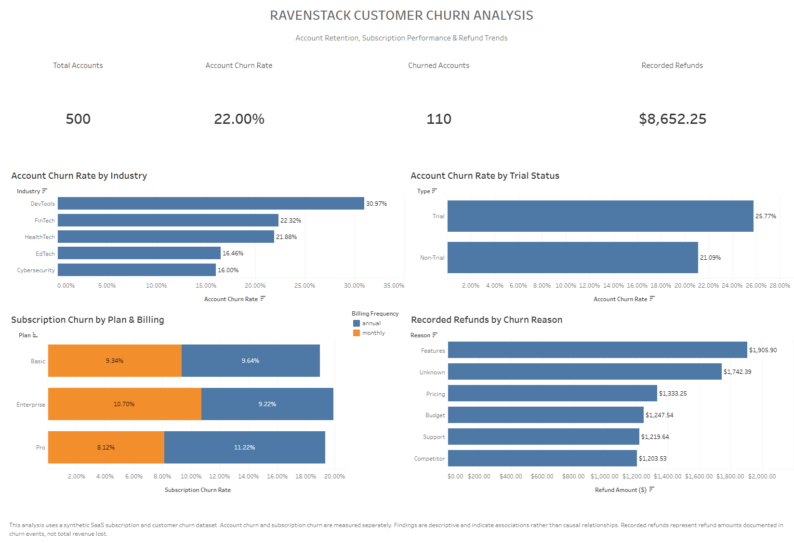

# RavenStack-Customer-Churn-Analysis

## Interactive Dashboard

[View the Interactive Tableau Dashboard](https://public.tableau.com/views/customerchurn_17920307298900/Dashboard1)

Explore customer churn rates, subscription performance, and recorded refunds through the interactive Tableau dashboard.

### Dashboard Preview

## Project Overview

This project analyzes customer churn for a fictional SaaS company, RavenStack, using a synthetic subscription and customer dataset.

The goal was to explore customer retention patterns, identify differences in churn across customer segments and subscription plans, and examine recorded refunds by churn reason.

The analysis uses five related datasets covering customer accounts, subscriptions, product usage, support tickets, and churn events.

The project combines SQL, Python, and Tableau to investigate churn patterns and present findings through an interactive dashboard.

## Business Questions

The analysis focused on answering the following questions:

1. What is the overall customer account churn rate?
2. Which customer industries have the highest churn rates?
3. Do trial customers have different churn rates than non-trial customers?
4. How does subscription churn vary across plan tiers and billing frequencies?
5. Are there differences in product usage between retained and churned customers?
6. How do support ticket escalations compare between retained and churned accounts?
7. Which recorded churn reasons account for the highest refund amounts?

## Tools & Technologies

- **SQL (MySQL):** Data exploration, aggregation, calculations, and analysis across related datasets.
- **Python:** Data analysis and visualization using pandas and matplotlib.
- **Tableau Public:** Interactive dashboard development and data visualization.
- **GitHub:** Project documentation, version control, and portfolio presentation.

## Dataset

Source: [SaaS Subscription and Churn Analytics Dataset – Kaggle](https://www.kaggle.com/datasets/rivalytics/saas-subscription-and-churn-analytics-dataset)

The dataset contains five related tables:

| Table | Rows | Description |
|---|---:|---|
| Accounts | 500 | Customer account information |
| Subscriptions | 5,000 | Subscription plans and billing details |
| Feature Usage | 25,000 | Customer product usage activity |
| Support Tickets | 2,000 | Customer support interactions |
| Churn Events | 600 | Churn-related events and recorded refunds |

The data was imported into MySQL and analyzed using relationships between the five tables.

## Analysis & Methodology

The project followed several stages:

1. **Data Preparation:** Imported the datasets into MySQL, reviewed table structures, and addressed data quality issues.
2. **SQL Analysis:** Explored customer churn, subscription performance, industry segments, trial status, support escalations, product usage, and recorded refunds.
3. **Python Analysis:** Used pandas to further investigate churn patterns and create visualizations.
4. **Dashboard Development:** Built an interactive Tableau dashboard to present the primary findings and key performance indicators.
5. **Documentation:** Organized the analysis, findings, and dashboard into a GitHub portfolio project.

## Key Findings

### Customer Account Churn

- Overall account churn rate was **22.00%**, representing 110 churned accounts out of 500.
- DevTools had the highest industry churn rate at **30.97%**.
- Trial accounts had a churn rate of **25.77%**, compared with **21.09%** for non-trial accounts.

### Subscription Performance

- Subscription churn was **9.72%**, representing 486 churned subscriptions out of 5,000.
- Pro annual subscriptions had the highest churn rate at **11.22%**.
- Enterprise monthly subscriptions followed at **10.70%**.

### Product Usage & Support

- Churned accounts showed slightly higher average total product usage than retained accounts.
- Average usage was 522.04 among churned accounts compared with 495.13 among retained accounts.
- Support ticket escalation rates were 20.91% for churned accounts and 17.44% for retained accounts.

### Recorded Refunds

- Total recorded refunds were **$8,652.25**.
- Feature-related churn events accounted for the largest refund amount at **$1,905.90**.
- Unknown churn reasons accounted for another **$1,742.39** in recorded refunds.

## Limitations & Considerations

- The dataset is synthetic and does not represent actual company or customer records.
- Account churn and subscription churn are measured separately and should not be treated as interchangeable metrics.
- Churn events can include multiple records for the same account; event counts do not necessarily represent unique customers.
- Recorded refunds represent amounts documented in churn events, not total revenue lost.
- The analysis is descriptive. Observed differences and associations do not establish causation.

## Conclusion

This project demonstrates an end-to-end data analysis workflow using SQL, Python, and Tableau.

By combining multiple related datasets, I explored customer retention, subscription performance, product usage, support interactions, and recorded refunds. The resulting dashboard provides an interactive overview of the findings and highlights areas that could warrant further investigation.
